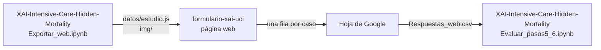

# formulario-xai-uci

**Página del formulario:** https://rosi1207.github.io/formulario-xai-uci/

Formulario web del **estudio B** de la etapa 3 (evaluación basada en humanos, pasos 5 y 6) del proyecto **[XAI-Intensive-Care-Hidden-Mortality](https://github.com/rosi1207/XAI-Intensive-Care-Hidden-Mortality)**.

El proyecto evalúa las explicaciones de una red neuronal que predice la **mortalidad oculta** de pacientes egresados de una Unidad de Cuidados Intensivos (UCI). Este repositorio contiene solo la página con la que médicos y estudiantes de Medicina valoran casos reales con y sin la ayuda del modelo y de sus explicaciones. El modelo, las explicaciones, las demás etapas de la evaluación y el análisis de las respuestas están en el repositorio principal.

---

## Contenido

1. [Contexto](#1-contexto)
2. [Relación con el repositorio principal](#2-relación-con-el-repositorio-principal)
3. [Qué hace el participante](#3-qué-hace-el-participante)
4. [Los casos](#4-los-casos)
5. [Qué se pregunta](#5-qué-se-pregunta)
6. [Qué se registra](#6-qué-se-registra)
7. [Cómo se analizan las respuestas](#7-cómo-se-analizan-las-respuestas)
8. [Estructura del repositorio](#8-estructura-del-repositorio)
9. [Privacidad y ética](#9-privacidad-y-ética)
10. [Limitaciones](#10-limitaciones)

---

## 1. Contexto

**Mortalidad oculta** es el fallecimiento de pacientes que, tras mejorar y ser egresados de la UCI, no sobreviven al resto de su hospitalización. Detectar al egresar a los pacientes de alto riesgo permitiría vigilarlos más o reconsiderar el egreso.

El modelo es un perceptrón multicapa entrenado con 206 pacientes de la UCI del Hospital Universitario «Arnaldo Milián Castro» (Santa Clara, Cuba), de 2014–2015. Usa 6 variables: edad, diagnósticos de ingreso 1 y 2, diagnóstico de egreso 2, APACHE II y días de ventilación mecánica. Clasifica como **alto riesgo** a partir de una probabilidad del 32 %, un umbral elegido para no dejar escapar fallecidos aunque haya más falsas alarmas.

El proyecto evalúa las explicaciones en tres etapas progresivas:

| Etapa | Pasos | Qué se evalúa | Dónde |
|---|---|---|---|
| 1. Recursos computacionales | 1–3 | Fidelidad, robustez, complejidad, LSE y *sanity checks* | Repositorio principal |
| 2. Conocimiento del dominio | 4 | Coincidencia con la relevancia que dan los médicos a cada variable | Repositorio principal |
| 3. Humanos | 5–6 | Percepción de las explicaciones e impacto en la decisión clínica | Estudio A (Excel) en el repositorio principal · **Estudio B (esta página)** |

**Pregunta de este estudio.** ¿Ayudan las explicaciones a decidir mejor sobre el riesgo de mortalidad oculta, y cambia su efecto según la experiencia de quien decide? La hipótesis es que quien tiene menos experiencia se fía más del modelo, y por eso lo sigue más cuando se equivoca.

## 2. Relación con el repositorio principal

La etapa 3 tiene **dos estudios complementarios**, con los mismos casos y las mismas medidas pero con participantes y diseño distintos:

| | **Estudio A — formularios Excel** | **Estudio B — esta página** |
|---|---|---|
| Participantes | Intensivistas de contacto, vinculados al proyecto | Abierto: estudiantes, médicos generales, residentes y especialistas |
| Qué ve cada uno | Los 15 casos en todas las etapas | Un caso cada vez, con un solo método de explicación |
| Cuestionario | Una vez por método, sobre todas sus explicaciones | Una vez por caso, sobre esa explicación |
| Papel | **Principal:** el juicio de expertos | **Secundario:** cómo cambia el efecto de la explicación con la experiencia |

El flujo entre los dos repositorios:



- Los casos y las figuras ([datos/estudio.js](datos/estudio.js) e [img/](img/)) se **generan** en el repositorio principal con `Evaluations_Stage3/Exportar_web.ipynb`. Son los mismos casos, figuras, escala y método de cálculo que en los formularios Excel, y no se editan a mano.
- Las respuestas llegan a una hoja de Google mediante [apps-script/Codigo.gs](apps-script/Codigo.gs). Se descargan y se analizan en el repositorio principal con `Evaluations_Stage3/Evaluar_pasos5_6.ipynb`, junto con la clave del estudio (`clave_estudio.xlsx`). Esa clave contiene el desenlace real de cada caso y **no forma parte de este repositorio**.

**Antecedente.** El primer trabajo con esta base de casos es [acferriol/Intensive-Care-Hidden-Mortality](https://github.com/acferriol/Intensive-Care-Hidden-Mortality) (Cespón Ferriol et al., 2025), que entrenó los primeros modelos y ofreció sus explicaciones a los médicos en una aplicación Streamlit.

## 3. Qué hace el participante

1. **Bienvenida.** Lee qué es la mortalidad oculta y en qué consiste el estudio, y acepta participar.
2. **Perfil** (solo la primera vez en cada dispositivo). Las preguntas dependen de la situación que declare:

   | Pregunta | A quién se le hace |
   |---|---|
   | Situación: estudiante, médico general, residente o especialista | Todos |
   | Año de la carrera | Estudiantes |
   | Años de graduado | Médicos generales, residentes y especialistas |
   | Especialidad | Residentes y especialistas |
   | Año de residencia | Residentes |
   | Años de especialista | Especialistas |
   | Años de experiencia en UCI | Todos |

3. **Un caso**, elegido al azar entre los que aún no ha respondido. Lo valora en **tres pantallas seguidas**, sin poder volver atrás:
   1. **Sin modelo:** solo los datos del paciente.
   2. **Con la predicción del modelo:** alto o bajo riesgo y la probabilidad estimada.
   3. **Con la predicción y la explicación** de un método. La explicación es una gráfica de barras: rojo = el dato aumenta el riesgo, azul = lo disminuye.
4. **Cuestionario** de los pasos 5 y 6 sobre la explicación que acaba de ver.
5. **Otro caso**, si quiere. Cada caso respondido es independiente.

**Asignación del método** ([js/asignacion.js](js/asignacion.js)). Los métodos se muestran con nombres neutros («Método A» y «Método B») para que el participante no sepa cuál es cuál. La asignación está equilibrada como un cuadrado latino: cada participante ve los métodos alternados de un caso a otro, y cada caso recibe los dos métodos entre participantes. Así ningún método queda asociado a los casos más difíciles.

## 4. Los casos

Son **15 pacientes reales** de la cohorte, los mismos del estudio A, elegidos al azar dentro de cada tipo de acierto del modelo (4 verdaderos positivos, 3 falsos negativos, 4 falsos positivos y 4 verdaderos negativos). Los 3 falsos negativos son todos los de la cohorte: son los fallecidos que el modelo no detecta, y en ellos se mide la consecuencia más grave de fiarse del modelo.

En cada caso se muestra:
- **Datos del paciente:** edad, diagnósticos de ingreso 1 y 2, diagnóstico de egreso 2, APACHE II y días de ventilación mecánica.
- **Predicción** del modelo que no vio a ese paciente al entrenar, con su probabilidad.
- **Explicación** de ese mismo modelo, con el mismo formato y escala para los dos métodos (versión de escritorio y de móvil).

La página **no contiene** el desenlace real, el tipo de acierto del modelo ni el modelo.

## 5. Qué se pregunta

### Decisión (en cada una de las tres pantallas)

- *¿Considera que este paciente tiene ALTA o BAJA probabilidad de fallecer después del egreso de la UCI?*
- *¿Cuánta confianza tiene en su valoración?* (50 %, 60 %, 70 %, 80 %, 90 %, 100 %)

### Paso 5 — Percepción de la explicación

| Ítem | Constructo | Escala | Enunciado |
|---|---|---|---|
| T1 | Confianza | 1–7 | Tengo confianza en esta explicación sobre el riesgo de los pacientes. |
| D1 | Desconfianza | 1–7 | Tengo recelo de esta explicación sobre el riesgo de los pacientes. |
| S1 | Comprensibilidad | 1–5 | A partir de estas explicaciones, entiendo cómo el sistema llegó a la predicción de mortalidad oculta. |
| S2 | Comprensibilidad | 1–5 | Estas explicaciones me permiten anticipar qué predicciones daría el sistema en pacientes similares. |
| S3 | Comprensibilidad | 1–5 | Estas explicaciones me ayudarían a notar si el sistema se equivocó en el riesgo de un paciente. |
| S4 | Comprensibilidad | 1–5 | Podría explicarle a un colega el razonamiento del sistema para los pacientes. |
| S5 | Comprensibilidad | 1–5 | Gracias a esta explicación, sé qué tan confiable es cada predicción para estos pacientes en particular. |
| I1 | Interpretabilidad | 1–5 | Los términos y el formato de las explicaciones me resultaron familiares. |
| I2 | Interpretabilidad | 1–5 | Pude identificar, sin mucho esfuerzo, qué factores de los pacientes destaca cada explicación. |
| I3 | Interpretabilidad | 1–5 | La relación entre los factores señalados y el riesgo de cada paciente tiene sentido clínico para mí. |

Comentario libre: *¿Qué le ayudó o le confundió de la explicación?*

### Paso 6 — Impacto en la decisión

| Ítem | Constructo | Escala | Enunciado |
|---|---|---|---|
| U1 | Utilidad | 1–5 | Estas explicaciones fueron fáciles de usar para apoyar mi valoración de cada paciente. |
| C1 | Causabilidad | 1–5 | La explicación incluyó los factores relevantes para cada paciente, con precisión suficiente. |
| C2 | Causabilidad | 1–5 | Pude usar estas explicaciones junto con mi conocimiento clínico. |
| C3 | Causabilidad | 1–5 | No encontré inconsistencias entre las explicaciones y la evolución clínica esperada de cada paciente. |
| C4 | Causabilidad | 1–5 | No necesité referencias adicionales (p. ej. guías clínicas) para interpretar estas explicaciones. |
| C5 | Causabilidad | 1–5 | Estas explicaciones cambiarían cómo yo monitorizaría o trataría a los pacientes. |

Comentario libre: *¿Cambiaría algo en su manejo de este paciente? ¿Por qué?*

Escalas: 1–7 de «Nada» a «Extremadamente»; 1–5 de «Totalmente en desacuerdo» a «Totalmente de acuerdo». Las fuentes de cada ítem (S-TIAS, Jian et al., Mueller et al., Biran y Cotton, Miller, *System Causability Scale*…) están en el README del repositorio principal (sección 7.4).

## 6. Qué se registra

Cada caso respondido es **una fila** en la hoja de Google, con:
- el código aleatorio del participante (uno por dispositivo) y su perfil;
- el caso, el método mostrado y la versión del estudio;
- la decisión y la confianza en cada etapa;
- las respuestas y comentarios del cuestionario;
- el tiempo de cada pantalla, que se registra solo;
- el navegador y el ancho de pantalla, para poder analizar si responder desde el móvil influye.

No se pide nombre, correo ni institución. Si falla la conexión, la respuesta queda guardada en el navegador y se envía la próxima vez que se abra la página.

## 7. Cómo se analizan las respuestas

El análisis se hace en el repositorio principal y sigue un plan fijado el 13 de octubre de 2026, antes de recoger las respuestas (README principal, sección 7.5). En resumen:

- **Grupos** según el perfil: G1 especialistas en Medicina Intensiva, G2 residentes de Medicina Intensiva, G3 especialidades afines, G4 médicos generales y G5 estudiantes.
- **Control de calidad:** se excluyen las respuestas de prueba, las repetidas, las que tienen alguna pantalla de decisión de menos de 5 segundos y los perfiles inverosímiles.
- **Medidas objetivas:** exactitud, acuerdo con el modelo, RAIR y RSR (confianza apropiada; Schemmer et al., 2023), sobreconfianza e infraconfianza, **cambio perjudicial en los falsos negativos**, mejora neta, calibración de la confianza y tiempo.
- **Medidas subjetivas:** puntuación de cada constructo del cuestionario, por método y por grupo.
- Los estudios A y B **no se mezclan**: el B se analiza por separado y por grupo, y la comparación con los expertos del estudio A es solo descriptiva.

## 8. Estructura del repositorio

```
index.html              esqueleto de la página
css/estilos.css         estilos (tema claro/oscuro, móvil)
js/configuracion.js     URL de envío y opciones generales
js/textos.js            textos que ve el participante (bienvenida, consentimiento, preguntas)
js/almacen.js           memoria del navegador (perfil, casos hechos, envíos pendientes)
js/asignacion.js        qué caso y qué método ve cada participante
js/perfil.js            perfil con preguntas condicionales
js/vistas.js            construcción de las pantallas
js/envio.js             envío a la hoja de Google (con reintento si falla la conexión)
js/app.js               flujo, validación y tiempos
apps-script/Codigo.gs   código que recibe las respuestas en la hoja de Google
datos/estudio.js        casos, preguntas y diseño del estudio (GENERADO, no editar)
img/<metodo>/*.png      explicaciones de cada caso, escritorio y móvil (GENERADO, no editar)
```

## 9. Privacidad y ética

<!-- - La página es **pública** y muestra datos clínicos reales de 15 pacientes, sin nombres pero con edad, diagnósticos, APACHE y días de ventilación, también dentro de las figuras. Su publicación debe estar cubierta por la aprobación del comité de ética. Si no lo está, los casos se exportan con la edad en rangos (`EDAD_EN_RANGOS = True` en el repositorio principal) o se restringe el acceso. -->
<!-- - El texto de consentimiento ([js/textos.js](js/textos.js)) debe coincidir con el aprobado por el comité. -->
- Los participantes son anónimos: solo se identifican con un código aleatorio por dispositivo.

## 10. Limitaciones

- **Muestra autoseleccionada** y perfil declarado, no verificado.
- **Un participante = un dispositivo:** quien responde desde dos dispositivos cuenta como dos participantes.
- **Anclaje:** las tres decisiones de un caso van seguidas, así que la decisión con explicación puede anclarse en la anterior.
- **Proporción de errores del modelo:** con 3 falsos negativos y 4 falsos positivos entre 15 casos, el modelo se equivoca en casi la mitad, más que en la cohorte (≈ 25 %). Eso permite medir la sobreconfianza, pero el participante puede percibir que el modelo falla mucho.
- **Enlace abierto:** cualquiera con el enlace puede responder; el control de calidad filtra las respuestas no válidas antes del análisis.
